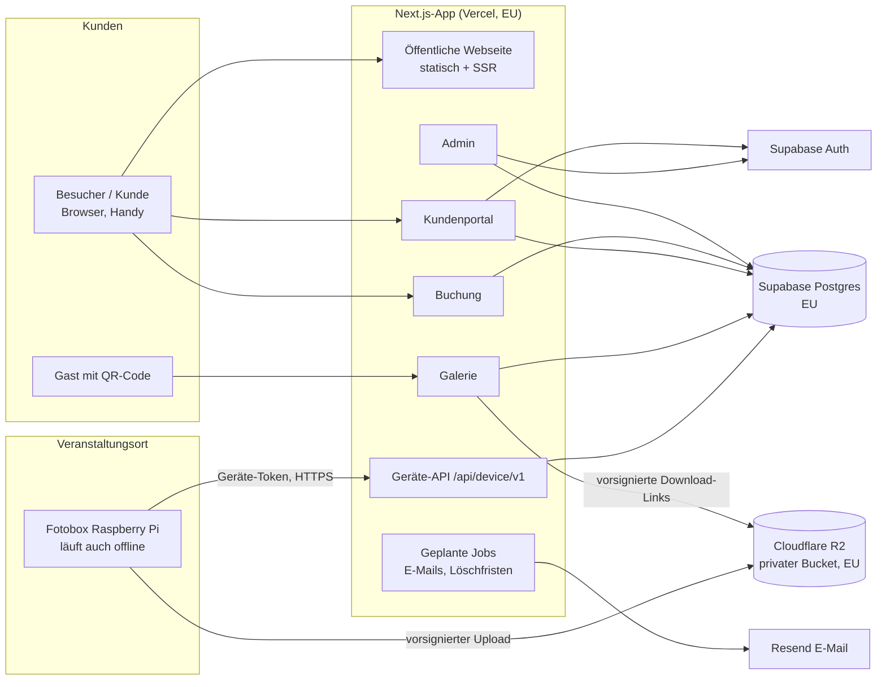

# Architektur – Fotikaste-Plattform

Stand: 2026-11-25 · Status: **Vorschlag (Phase 0), noch nicht freigegeben**

## 1. Grundprinzip
Ein **modularer Monolith**: eine einzige Next.js-Anwendung mit klar getrennten Modulen, eine PostgreSQL-Datenbank,
ein privater Fotospeicher. Keine Microservices. Die Fotobox bleibt ein **eigenständiges Gerät**, das die Cloud nur nutzt,
wenn Internet da ist.

> **Modularer Monolith** – *Was?* Ein Programm, intern in Module geteilt. *Wozu?* Einfach zu betreiben (ein Deployment),
> trotzdem ordentlich getrennt. *Wie?* Jedes Modul hat einen eigenen Ordner und spricht andere nur über definierte Funktionen an.
> *Wo?* `src/modules/booking`, `src/modules/gallery`, …

## 2. Architekturvarianten

| | **A – Managed (empfohlen)** | B – Eigener Server | C – Cloudflare-only |
|---|---|---|---|
| App | Next.js auf **Vercel** (Region Frankfurt) | Next.js in Docker auf VPS (Infomaniak/Hetzner) | Next.js auf Cloudflare Workers (OpenNext) |
| Datenbank | **Supabase Postgres** (EU) | eigenes Postgres | Neon oder Supabase |
| Login | Supabase Auth (Magic Link, TOTP-2FA) | Auth-Bibliothek selbst betreiben | Bibliothek |
| Fotos | **Cloudflare R2, privat** | R2 | R2 |
| E-Mail | Resend (EU-Region) | Resend | Resend |
| Wartung | gering | **hoch** (Updates, Backups, Firewall selbst) | mittel (Kompatibilitätsfragen) |
| Kosten/Monat* | ca. CHF 45–55 | ca. CHF 10–25 | ca. CHF 5–30 |
| Eignung Anfänger | ✅ | ❌ | ⚠️ |

\*Details und Annahmen in `COSTS.md`. Alle Preise vor Entscheid auf den offiziellen Seiten prüfen.

**Empfehlung A**, weil du Einsteiger bist und Sicherheit/Backups bei Managed-Diensten professionell gelöst sind.
Die Abhängigkeit bleibt begrenzt: Postgres ist Standard-SQL (umziehbar), R2 spricht die Standard-S3-Schnittstelle.

## 3. Architekturdiagramm



## 4. Fotobox-Integration (ohne Eingriff in Kamera/Druck/Ablauf)

**Neu im Pi-Code (später, nur nach deiner Freigabe):** eine Klasse `PlattformGalerie(Galerie)` in `galerie.py`, wählbar
neben «simuliert» und «Cloudflare R2». Alles andere bleibt.

Ablauf pro Foto:
1. Gast will Foto aufs Handy → Fotobox erzeugt lokal `token = secrets.token_urlsafe(24)` (192 Bit).
   QR-Code zeigt `https://<domain>/f/<token>` – **funktioniert sofort, auch offline**.
2. Arbeiter (bestehende Warteschlange) fragt sobald online: `POST /api/device/v1/uploads` mit `{event_id, client_photo_id, sha256, token_hash}`.
3. Plattform prüft: Gerät aktiv? Event diesem Gerät zugewiesen? Foto schon vorhanden (gleiche `client_photo_id`)? → liefert **vorsignierte Upload-URL** (5 min gültig, nur dieser eine Objektpfad).
4. Pi lädt direkt in R2 hoch → `POST …/uploads/{id}/complete` → Plattform prüft Grösse/Prüfsumme, erstellt Vorschaubilder.
5. Ruft ein Gast `/f/<token>` auf, bevor das Foto da ist: freundliche Seite «Dein Foto ist noch unterwegs – bitte später nochmals öffnen».

Eigenschaften: **idempotent** (doppelter Upload erzeugt kein zweites Foto), Token in der DB nur als **Hash**
gespeichert, Pi besitzt **keinen** R2-Schlüssel mehr, Gerät sieht nur seine zugewiesenen Events, kein Fernzugriff auf den Pi.

> **Idempotent** – derselbe Auftrag zweimal ausgeführt hat dieselbe Wirkung wie einmal. Wichtig, weil die Fotobox bei
> Wackel-Internet nicht weiss, ob ein Upload angekommen ist, und ihn wiederholt.

Event-Konfiguration: Pi holt `GET /api/device/v1/config` (Eventname, Namen, Datum, Rahmen, Download an/aus, Druck-Kontingent)
und speichert sie lokal. Ohne Internet läuft er mit der zuletzt bekannten Konfiguration bzw. manueller Einstellung weiter.

## 5. Seitenstruktur

### Öffentlich (indexierbar, statisch/serverseitig gerendert)
| URL | Zweck |
|---|---|
| `/` | Startseite (Hero, Erlebnis, Vorteile, Ablauf, Pakete, Anlässe, Galerie, FAQ, CTA) |
| `/fotobox` | Produktseite (Technik, Masse, Platz, Strom, Druck, Galerie) |
| `/preise` | Pakete + Zusatzleistungen + Vergleichstabelle + Lieferkosten |
| `/verfuegbarkeit` | Kalender mit sofortiger Prüfung → Buchung |
| `/hochzeit`, `/geburtstag`, `/firmenanlass` | Anlassseiten mit eigenem Inhalt |
| `/fotobox-thurgau`, `/fotobox-ostschweiz` (weitere nur bei echtem Liefergebiet) | Regionalseiten |
| `/ratgeber`, `/ratgeber/[slug]` | Ratgeber-Beiträge |
| `/galerie` | Beispielfotos (nur mit Einwilligung) |
| `/faq`, `/ueber-uns`, `/kontakt` | |
| `/impressum`, `/datenschutz`, `/agb` | Rechtstexte (Entwurf bis geprüft) |

`/fotobox-mieten` wird **nicht** separat gebaut (würde mit `/` konkurrieren) – die Startseite zielt auf «Fotobox mieten».

### Buchung (nicht indexiert)
`/buchen` → Schritte Datum · Paket · Extras · Event · Kontakt · Übersicht · Bestätigung (`/buchen/danke`).

### Geschützt (Zugriffskontrolle, zusätzlich noindex)
| Bereich | URL | Zugang |
|---|---|---|
| Kundenportal | `/konto`, `/konto/buchung/[id]` | Magic Link |
| Event-Galerie | `/event/[slug]` | standardmässig gesperrt; Veranstalter gibt frei, optional Passwort |
| Einzelfoto | `/f/[token]` | nur mit Token |
| Admin | `/admin/...` (Dashboard, Buchungen, Kalender, Events, Kunden, Rechnungen, Finanzen, Geräte, Inhalte, SEO, Einstellungen) | Konto + 2FA + Rolle |
| Geräte-API | `/api/device/v1/...` | Geräte-Token |

## 6. Rollen und Berechtigungen (Prinzip minimaler Rechte)

| Recht | Eigentümer | Admin | Mitarbeiter | Kunde | Gast | Gerät |
|---|:-:|:-:|:-:|:-:|:-:|:-:|
| Öffentliche Seiten | ✅ | ✅ | ✅ | ✅ | ✅ | – |
| Buchen | ✅ | ✅ | ✅ | ✅ | ✅ | – |
| Eigene Buchung/Rechnung sehen | – | – | – | ✅ eigene | – | – |
| Eigene Galerie verwalten (freigeben, Passwort) | ✅ | ✅ | – | ✅ eigene | – | – |
| Freigegebenes Einzelfoto | ✅ | ✅ | – | ✅ | ✅ mit Token | – |
| Buchungen/Kalender sehen | ✅ | ✅ | ✅ | – | – | – |
| Buchungen ändern/stornieren | ✅ | ✅ | ⚠️ nur Status/Notizen | – | – | – |
| Rechnungen ausstellen/stornieren | ✅ | ✅ | – | – | – | – |
| Finanzen, Wirtschaftlichkeit | ✅ | – | – | – | – | – |
| Preise, Pakete, Inhalte | ✅ | ✅ | – | – | – | – |
| Geräte registrieren/widerrufen | ✅ | ✅ | – | – | – | – |
| Benutzer & Rollen verwalten | ✅ | – | – | – | – | – |
| Config des zugewiesenen Events lesen | – | – | – | – | – | ✅ |
| Fotos ins zugewiesene Event hochladen | – | – | – | – | – | ✅ |
| Status/Zähler melden | – | – | – | – | – | ✅ |

Durchsetzung **doppelt**: in der Server-Logik (jede Aktion prüft Rolle) **und** in der Datenbank (Row Level Security).
2FA Pflicht für Eigentümer, Admin, Mitarbeiter.

## 7. Projektstruktur (geplant für Phase 1)
```
Plattform/
  src/app/(public)/...      öffentliche Seiten
  src/app/buchen/...        Buchungsstrecke
  src/app/konto/...         Kundenportal
  src/app/admin/...         Administration
  src/app/api/device/v1/... Geräte-API
  src/modules/<modul>/      Logik je Modul (booking, pricing, gallery, devices, invoices, content, mail)
  src/lib/                  Datenbank, Auth, Geld, Zeit (Europe/Zurich)
  supabase/migrations/      Datenbank-Migrationen (SQL, versioniert)
  tests/                    Unit, Integration, Playwright
  tools/fotobox-simulator/  Simulator für Geräte-API
```

## 8. Querschnittsregeln
- **Geld** immer als ganze Rappen (`integer`), nie Kommazahlen. Anzeige `CHF 1'250.00`.
- **Zeit** in der DB als `timestamptz` (UTC); Anzeige und Tagesgrenzen in `Europe/Zurich`.
- **Preise** werden nur serverseitig berechnet; Browser sendet nur Auswahl (Paket-ID, Extras-IDs).
- **E-Mails** über eine Ausgangs-Warteschlange mit eindeutigem Schlüssel (keine Doppel-Mails); Testmodus leitet alles an deine Adresse um.
