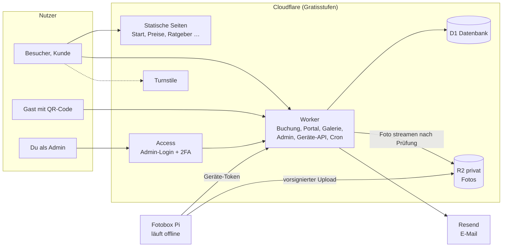

# Architektur – Fotikaste-Plattform

Stand: 2026-11-25 (Version 2) · Status: **überarbeitet nach Vorgabe «CHF 0 pro Monat»**, wartet auf Freigabe (Entscheide E1–E3 in `README.md`)

> Version 1 (Vercel + Supabase, ca. CHF 45–70/Monat) ist ersetzt, siehe `DECISIONS.md` ADR-009.

## 1. Grundprinzip
Alles läuft auf deinem **bestehenden Cloudflare-Konto** in den Gratisstufen. Eine Anwendung, eine Datenbank, ein privater
Fotospeicher. Öffentliche Seiten werden **beim Bauen fertig erzeugt** (statisch) und verbrauchen keine Rechenzeit. Nur Buchung,
Portal, Galerie, Admin und Geräte-API laufen als kleine Server-Funktionen (Worker).

**Einzige Kostenquelle mit Restrisiko:** R2 (bei hinterlegter Zahlungsmethode wird Mehrverbrauch verrechnet). Dagegen gibt es
harte Grenzen in der App, siehe §7. Alle anderen Dienste **sperren** bei Erreichen des Limits statt zu verrechnen.

## 2. Bausteine

| Aufgabe | Dienst (Gratisstufe) | Warum |
|---|---|---|
| Webseite + Server-Funktionen | **Cloudflare Workers** mit statischen Assets | Statische Dateien gratis und unbegrenzt; 100 000 Worker-Aufrufe/Tag |
| Framework | **Astro** (empfohlen, Entscheid E2) | Erzeugt statische Seiten (ideal für SEO/Ladezeit), Server-Seiten nur wo nötig; gehört seit Jan. 2026 zu Cloudflare, bleibt Open Source (MIT) |
| Datenbank | **Cloudflare D1** (SQLite) | 5 Mio. gelesene / 100 000 geschriebene Zeilen pro Tag, 500 MB pro DB, 7 Tage Time Travel |
| Fotos | **Cloudflare R2**, neuer **privater** Bucket, EU-Jurisdiktion | Bereits vorhanden; 10 GB, 1 Mio. Schreib-/10 Mio. Lesevorgänge pro Monat; Download gratis |
| Admin-Schutz | **Cloudflare Access** (Zero Trust Free, < 50 Benutzer) | Login vor der App, mit Google/GitHub inkl. deren 2FA; App prüft das Access-Token zusätzlich |
| Bot-Schutz | **Cloudflare Turnstile** | Gratis-Captcha-Alternative für Buchung und Magic-Link-Anfrage |
| E-Mail senden | **Resend Free** | 100/Tag, 3 000/Monat, blockiert bei Limit (kein Mehrverbrauch) |
| E-Mail empfangen | **Cloudflare Email Routing** | `info@<domain>` → dein bestehendes Postfach |
| Zeitgesteuerte Aufgaben | Worker **Cron Triggers** (5 gratis) | Reservierungen aufräumen, E-Mails, Löschfristen, Verbrauchsprüfung |
| Code | **GitHub Free** (privates Repository) | Versionen, Sicherung; GitHub Actions für Tests/Deploy |
| Bilder der Webseite | beim Bauen optimiert (AVIF/WebP) | kein kostenpflichtiger Bilddienst |

### Bewusst NICHT verwendet
Cloudflare Images (verrechnet), Workers Paid (USD 5/Monat), Vercel, Supabase, kostenpflichtige Analyse-Tools.

## 3. Architekturdiagramm



## 4. Sichere Anmeldung ohne Supabase

| Wer | Verfahren | Details |
|---|---|---|
| **Admin (du)** | Cloudflare Access vor `/admin/*` und `/api/admin/*` | Anmeldung über Google- oder GitHub-Konto **mit eingeschalteter 2FA**; Access-Regel erlaubt nur deine E-Mail-Adresse. Der Worker prüft bei jeder Anfrage die Signatur des Access-Tokens (`Cf-Access-Jwt-Assertion`), damit ein Umgehen der Vorschaltung nichts nützt. Kein Passwort in unserer DB. |
| **Kunde** | Eigener Magic Link | Zufallstoken 256 Bit, in D1 nur als SHA-256-Hash, 15 min gültig, einmal verwendbar. Danach Sitzungs-Cookie (`HttpOnly`, `Secure`, `SameSite=Lax`, 30 Tage, Sitzungs-ID als Hash in D1, jederzeit widerrufbar). Anfrage geschützt durch Turnstile + Begrenzung (max. 5 Links/E-Mail/Stunde). |
| **Gast** | Foto-Token im QR-Code | 192 Bit, nur Hash in D1, Ablaufdatum |
| **Fotobox** | Geräte-Token | einmal im Admin angezeigt, nur Hash in D1, widerrufbar, nur Upload ins zugewiesene aktive Event |
| **Mitarbeiter (später)** | Access-Regel um seine E-Mail erweitern + Rolle in D1 | |

> **Cloudflare Access** – *Was?* Eine Türsteher-Seite von Cloudflare vor einer Webadresse. *Wozu?* Niemand erreicht den Admin, ohne
> sich vorher bei Google/GitHub anzumelden. *Wie?* Cloudflare prüft die Anmeldung und gibt dem Browser ein signiertes Ticket mit,
> das unser Worker kontrolliert. *Wo?* `/admin`.

## 5. Doppelbuchungen verhindern mit D1
D1 kennt keine Ausschlussregel wie PostgreSQL. Dafür gelten zwei Eigenschaften, die wir ausnutzen:
1. **Jede D1-Datenbank verarbeitet Schreibvorgänge nacheinander** (ein Schreiber).
2. **`batch()` ist eine Transaktion**: scheitert ein Befehl, wird der ganze Stapel zurückgerollt (laut Cloudflare-Doku).

Lösung: Tabelle `allocation_days` mit **`UNIQUE(resource_id, day)`** – eine Zeile pro belegtem Tag und Ressource (Fotobox,
Liefer-Kapazität). Eine Reservierung schreibt in **einem** Batch:
```
1. DELETE abgelaufene Holds (und ihre Tage)
2. INSERT allocation (Typ hold, läuft in 15 min ab)
3. INSERT allocation_days für jeden belegten Tag inkl. Liefer-/Puffertag
```
Ist auch nur ein Tag schon vergeben, verletzt Schritt 3 die UNIQUE-Regel → der **ganze** Batch wird verworfen → der zweite Kunde
erhält «Dieser Termin wurde soeben vergeben» und Alternativen. Zwei gleichzeitige Kunden können also nie beide gewinnen.

Warum Tage statt Minuten? Eine Fotobox ist realistisch pro Tag einmal vermietet; Liefertag und Puffer werden als eigene Tage
gesperrt. Liefer-Kapazität: Ressource «Lieferung» mit `slot`-Nummer (z. B. max. 2 Lieferungen pro Tag = Slots 1 und 2).
Eine stundengenaue Planung (zwei kurze Anlässe am selben Tag) ist als spätere Erweiterung möglich (Halbtages-Slots).

## 6. Fotobox-Integration
Ablauf wie in Version 1 (Token entsteht auf der Fotobox → QR funktioniert offline), mit zwei Anpassungen für die Gratisstufe:
- Die **Fotobox erzeugt Vorschau- und Galeriebild selbst** (Pillow ist bereits installiert) und lädt drei Dateien hoch: Original,
  Web (ca. 1600 px), Vorschau (ca. 400 px). So braucht die Cloud keine Bildverarbeitung.
- Uploads gehen per **vorsignierter URL direkt in R2** (Worker erzeugt nur die Unterschrift, wenig Rechenzeit).
- **Gesamt-Download als ZIP** erzeugt der Browser des Kunden aus den Einzelbildern (keine Server-Rechenzeit).
Details: `API.md`, Migration vom heutigen öffentlichen Bucket: `R2_MIGRATION.md`.

## 7. Verbrauchsüberwachung und harte Grenzen

| Dienst | Gratisgrenze | Verhalten bei Überschreitung | Unsere Schutzmassnahme |
|---|---|---|---|
| Workers | 100 000 Aufrufe/Tag, 10 ms CPU | Fehler 1027/1102, **keine Kosten** | Öffentliche Seiten statisch (zählen nicht); Workers Paid nie aktivieren |
| D1 | 5 Mio. Lese-/100 000 Schreibzeilen/Tag, 500 MB | Abfragen scheitern, **keine Kosten** | Indizes, Zähler im Dashboard |
| Resend | 100/Tag, 3 000/Monat | Versand blockiert (HTTP 429) | Outbox: max. 80/Tag, Rest am nächsten Tag; Priorität Buchung > Erinnerung |
| **R2** | 10 GB, 1 Mio. A-, 10 Mio. B-Vorgänge/Monat | **wird verrechnet** (Zahlungsmittel hinterlegt) | Harte App-Grenzen (unten) + Cloudflare-Budgetwarnung |
| Cron | 5 Trigger | – | wir nutzen 2 |

**Harte R2-Grenzen in der App** (alle im Admin einstellbar):
- Gesamtspeicher-Obergrenze **8 GB** (Puffer zu 10 GB). Darüber verweigert die Geräte-API neue Uploads mit `507`; die Fotobox
  behält die Fotos lokal in der Warteschlange (Drucken geht weiter), Admin bekommt sofort eine Warnung.
- Max. 15 MB pro Original, max. 2 000 Fotos pro Event, Uploads nur für aktive Events.
- Monatszähler für Schreib-/Lesevorgänge in D1 mitgeführt; Stopp bei 80 % der Gratismenge.
- Löschfristen automatisch (Standard 30 Tage) + R2-Lifecycle-Regel als zweite Sicherung.
- Downloads gehen durch den Worker (Rate-Limit pro Token), damit niemand massenhaft abruft.

**Warnungen:** täglicher Cron berechnet Verbrauch (eigene Zähler, optional Cloudflare-Analyse-API) und schickt bei 50/80/95 %
eine E-Mail; Anzeige «Verbrauch» im Admin-Dashboard. Zusätzlich richtest **du** im Cloudflare-Dashboard eine Budgetwarnung bei
USD 1 ein (Cloudflare-Budgetwarnungen informieren nur, sie stoppen nichts – deshalb die App-Grenzen).

## 8. Seitenstruktur, Rollen, Sprachen
- Seitenstruktur und Rollenmatrix unverändert gegenüber Version 1 (siehe `PHASE0_ANALYSE.md`, Abschnitt Rollen in `SECURITY.md`).
- **Sprachen:** Schweizer Hochdeutsch (`de-CH`) ohne Präfix; später `/fr/`, `/it/`, `/en/`. Alle Texte von Anfang an über
  Übersetzungsschlüssel bzw. Inhaltstabellen mit Spalte `locale`; `hreflang` wird erst ausgegeben, wenn eine Sprache existiert.
- **Markenname zentral:** eine Konfigurationsdatei `src/config/brand.ts` (Name, Kurzname, Domain, Farben, Logo-Pfade); E-Mails,
  Rechnungen, JSON-LD und Meta-Titel lesen nur daraus.

## 9. Was diese Architektur nicht oder schlechter kann (ehrliche Auswirkungen)

| Thema | Auswirkung | Umgang |
|---|---|---|
| Keine Garantie/Haftung für Gratisdienste | Cloudflare darf Free Services ändern oder beenden | Standard-Technik (SQLite, S3), Export jederzeit möglich |
| 10 ms CPU pro Aufruf | Keine aufwendigen Berechnungen auf dem Server | Bilder auf der Fotobox, PDF/ZIP im Browser, statische Seiten |
| PDF-Rechnungen | Kein Server-PDF | Rechnung wird im Admin-Browser als PDF erzeugt, unveränderlich in R2 abgelegt (Hash in D1) |
| Backups | Time Travel nur 7 Tage | Wöchentlicher Export (`wrangler d1 export`) per GitHub Actions in privaten R2-Ordner + lokale Kopie |
| E-Mail-Daten in den USA (Resend) | Auftragsbearbeiter im Ausland | DPA mit Standardvertragsklauseln vorhanden; in Datenschutzerklärung nennen; Alternativen bei Bedarf prüfen |
| Kreditkarten | Cloudflare-Free-Bedingungen verbieten das Verarbeiten von Kartendaten auf Free-Webseiten | Spätere Zahlung nur über gehostete Zahlungsseite des Anbieters (Kartendaten nie bei uns) – vor Umsetzung prüfen |
| D1-Datenstandort | Ort der D1-Daten nicht wählbar dokumentiert (gefunden: keine EU-Option auf den Seiten) | Nur nötige Personendaten; in Datenschutzerklärung offenlegen; vor Go-Live erneut prüfen |
| Mehrere Anlässe pro Tag und Box | V1 tageweise | spätere Halbtages-Slots |

## 10. Projektstruktur (Phase 1)
```
Plattform/
  src/config/brand.ts        Markenname, Domain, Farben (einzige Quelle)
  src/pages/                 öffentliche Seiten (statisch) + Server-Seiten
  src/components/            Designsystem-Komponenten
  src/content/               Texte, FAQ, Ratgeber (später aus D1/Admin)
  src/server/                Module: booking, pricing, gallery, devices, invoices, mail, usage
  migrations/                D1-Migrationen (SQL)
  tests/                     Vitest (Logik, Worker) + Playwright
  tools/fotobox-simulator/   Geräte-Simulator
  wrangler.jsonc             Cloudflare-Konfiguration (ohne Geheimnisse)
```
Lokal läuft alles **ohne Internet und gratis**: `wrangler dev` simuliert Worker, D1, R2 und Cron auf deinem PC.
