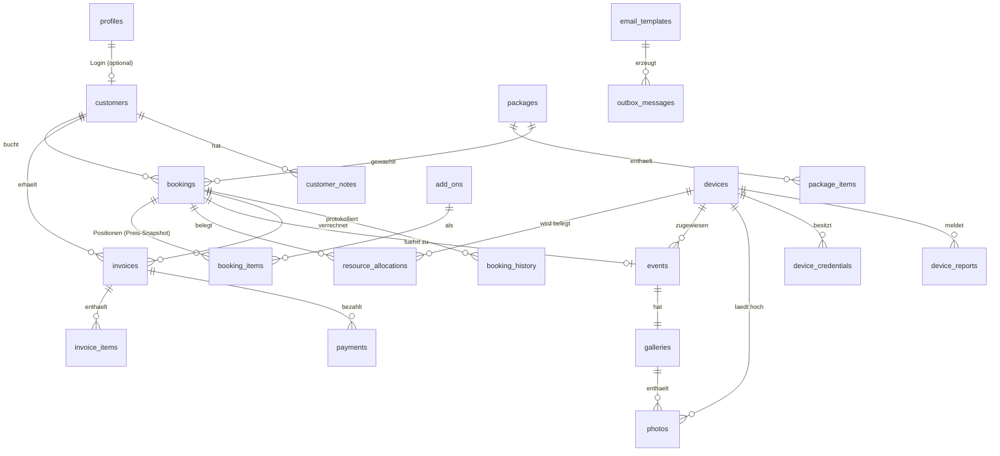

# Datenbank – vorläufiges Modell

Stand: 2026-11-25 · Status: **Entwurf (Phase 0)**. Umsetzung in Phase 2 über versionierte Migrationen (`supabase/migrations/`).

## Was ist ein ER-Diagramm?
**ER = Entity-Relationship** (Gegenstand–Beziehung). Jedes Kästchen ist eine **Tabelle** (z. B. `bookings`), jede Linie eine
**Beziehung**. Die Zeichen an den Linienenden sagen «wie viele»: `||` = genau eins, `o{` = keins oder mehrere.
Beispiel Fotikaste: *Ein Kunde hat keine oder mehrere Buchungen; jede Buchung gehört zu genau einem Kunden.*
Verbunden werden Tabellen über **Fremdschlüssel**: `bookings.customer_id` zeigt auf `customers.id`.

> **Primärschlüssel** – eindeutige Nummer jeder Zeile (`id`, bei uns UUID). **Fremdschlüssel** – Verweis auf den
> Primärschlüssel einer anderen Tabelle; die Datenbank verhindert Verweise ins Leere.

## ER-Diagramm (Kern)



## Tabellen (benötigt in V1 = ●, später = ○)

| Modul | Tabelle | | Zweck / wichtige Felder |
|---|---|---|---|
| Auth | `profiles` | ● | 1:1 zu Supabase `auth.users`; `role` (owner/admin/staff/customer), `totp_required` |
| CRM | `customers` | ● | Vorname, Nachname, Firma, E-Mail (eindeutig, klein geschrieben), Telefon, Rechnungsadresse, `profile_id?` |
| CRM | `customer_notes` | ● | Notizen + Kommunikationshistorie (Typ: Notiz, E-Mail, Anruf) |
| Katalog | `packages` | ● | Name, Slug, Grundpreis (Rappen), Mietdauer h, inkl. Abzüge, sichtbar, Reihenfolge |
| Katalog | `package_items` | ● | Leistungen eines Pakets (Text + optional Menge) |
| Katalog | `add_ons` | ● | Zusatzleistung, Preisart (pauschal / pro Stunde / pro 100 Abzüge), Preis |
| Katalog | `delivery_zones` | ● | PLZ-Bereiche, Lieferpauschale, Sofortbuchung ja/nein |
| Buchung | `bookings` | ● | Nummer, Status, Kunde, Paket, Event-Daten, Zeitraum, Adresse, Gäste, Lieferart, Gesamt (Snapshot), AGB-Version akzeptiert |
| Buchung | `booking_items` | ● | Preis-**Snapshot** jeder Position (Beschreibung, Menge, Einzelpreis) – spätere Preisänderungen ändern alte Buchungen nicht |
| Buchung | `resource_allocations` | ● | **Ersetzt `booking_holds` + `availability_blocks`**: Typ (hold/booking/maintenance/block), Gerät, Zeitraum inkl. Puffer, `expires_at` bei hold |
| Buchung | `booking_history` | ● | Jede Änderung: wer, wann, alt → neu |
| Geräte | `devices` | ● | Name, Seriennr., Status, Softwareversion, `last_seen_at` |
| Geräte | `device_credentials` | ● | Token-**Hash**, erstellt, widerrufen_am – mehrere pro Gerät für Wechsel |
| Geräte | `device_reports` | ● | Heartbeat: Zähler Fotos/Drucke, Warteschlange, Fehlermeldungen (begrenzt, 90 Tage) |
| Galerie | `events` | ● | Slug, Name, Booking, Gerät, Status, Layout/Rahmen-Konfiguration (JSON), Aufbewahrung bis |
| Galerie | `galleries` | ● | `shared` (Standard **false**), Passwort-Hash, Download erlaubt, ablauf_am |
| Galerie | `photos` | ● | Event, Gerät, `client_photo_id` (eindeutig pro Gerät → kein Doppel-Upload), Objektpfade (Original/Web/Vorschau), sha256, `access_token_hash`, Token-Ablauf, Status (pending/uploaded/ready/deleted) |
| Finanzen | `invoices` | ● | Nummer (fortlaufend, lückenlos), Status (draft/issued/paid/cancelled), Daten, Summen, **gesperrt nach Ausstellung** |
| Finanzen | `invoice_items` | ● | Positionen (Kopie, unveränderlich nach Ausstellung) |
| Finanzen | `payments` | ● | Betrag, Datum, Art (Überweisung/bar/später TWINT), Referenz |
| Finanzen | `expenses` | ○ | Ausgaben mit Kategorie (Investition, Verbrauch, Transport, Cloud, Marketing) und Art (effektiv/kalkulatorisch) |
| Mail | `email_templates` | ● | Schlüssel, Betreff, Text mit Platzhaltern, aktiv |
| Mail | `outbox_messages` | ● | **Ersetzt `email_logs`**: `dedupe_key` UNIQUE (z. B. `booking_confirmed:<id>`), Status, Versuche, Testmodus |
| Inhalte | `content_blocks`, `faqs`, `posts`, `redirects`, `seo_meta` | ● | Texte, FAQ, Ratgeber, Weiterleitungen, Titel/Beschreibung je Seite |
| System | `settings` | ● | Schlüssel/Wert: Druckkosten pro Abzug (Standard 0.15), MWST-pflichtig, Satz, Puffer-Stunden, Hold-Dauer |
| System | `audit_logs` | ● | Sicherheitsrelevante Aktionen (Login, Rollen, Rechnungen, Löschungen, Geräte) – nur anhängen, nie ändern |
| System | `rate_limits` | ○ | falls kein externer Dienst |

**Nicht übernommen:** `roles` (fixe Rollenliste genügt), `print_jobs` einzeln (Gerät meldet Zähler in `device_reports`; einzelne Druckaufträge bleiben auf dem Pi), `upload_jobs` (Status steht am Foto, die Warteschlange lebt auf dem Pi).

## Doppelbuchungen – von der Datenbank verhindert
PostgreSQL kann mit einer **Ausschlussregel** (Exclusion Constraint) garantieren, dass sich zwei Zeiträume desselben Geräts
nie überschneiden – auch wenn zwei Kunden in derselben Millisekunde buchen:

```sql
create extension if not exists btree_gist;
alter table resource_allocations add constraint no_overlap
  exclude using gist (device_id with =, period with &&)
  where (status = 'active');
```
`period` ist ein `tstzrange` **inklusive Liefer-, Auf-/Abbau- und Pufferzeit**. Ablauf beim Buchen:
1. Kunde wählt Datum → Server sucht freies Gerät und legt eine `hold`-Belegung an (15 min gültig).
2. Abgelaufene Holds werden in derselben Transaktion vor dem Einfügen auf `expired` gesetzt (zusätzlich minütlicher Job).
3. Beim Abschluss wird der Hold in eine `booking`-Belegung umgewandelt – nur, wenn er noch gültig ist.
4. Scheitert die Regel, bekommt der zweite Kunde «Dieses Datum wurde soeben vergeben» und Alternativen.

**Liefer-Kapazität** (du als Person): zusätzliche Ressource `staff` in derselben Tabelle, damit z. B. maximal eine
Lieferung pro Zeitfenster geplant wird. (Konfigurierbar, in V1 einfach gehalten.)

## Statusmodelle
- **Buchung:** `request` → `confirmed` → `deposit_paid` → `completed`; Seitenwege `cancelled` (mit Grund), `expired` (Anfrage nicht bestätigt).
- **Rechnung:** `draft` → `issued` → `paid` / `overdue` → Korrektur nur über **Gutschrift/Storno-Rechnung**, nie durch Bearbeiten.
- **Event:** `planned` → `active` (Gerät darf hochladen) → `closed` (Upload gesperrt) → `archived` (Fotos gelöscht).
- **Foto:** `pending` (Token reserviert) → `uploaded` → `ready` (Vorschaubilder fertig) → `deleted`.
- **Gerät:** `active` / `maintenance` / `retired`; Zugang einzeln widerrufbar.

## Löschregeln und Aufbewahrung (Entwurf, rechtlich zu prüfen)
| Daten | Aufbewahrung | Löschart |
|---|---|---|
| Event-Fotos | Standard 30 Tage nach Event, einstellbar (max. z. B. 365) | Objekte in R2 + Zeilen; täglicher Job |
| Abgebrochene Buchungs-Holds | 24 h | löschen |
| Anfragen ohne Buchung | 12 Monate | anonymisieren |
| Buchungen, Rechnungen, Zahlungen | **10 Jahre** (Schweizer Aufbewahrungspflicht für Geschäftsbücher, Art. 958f OR) | danach löschen; vorher nur sperren |
| Geräteberichte | 90 Tage | löschen |
| Audit-Logs | 2 Jahre | löschen |

Fremdschlüssel-Löschverhalten: Kunden mit Rechnungen können **nicht** gelöscht werden (`on delete restrict`), nur anonymisiert.
Fotos hängen mit `on delete cascade` an der Galerie.

## Zugriffsrechte (Row Level Security, Kurzfassung)
- Alle Tabellen: RLS **eingeschaltet**, Standard «kein Zugriff».
- `staff/admin/owner`: über Funktion `has_role()`; Finanzen nur `owner`.
- `customer`: nur Zeilen mit eigener `customer_id`.
- Gäste und Geräte greifen **nie direkt** auf die Datenbank zu, nur über Server-Endpunkte mit eigener Prüfung.
- Jede Policy erhält einen automatischen Test (Phase 2).

## Indizes (Auswahl)
`customers(lower(email))` unique · `bookings(status, event_start)` · `resource_allocations` GiST auf `period` ·
`photos(device_id, client_photo_id)` unique · `photos(access_token_hash)` unique · `outbox_messages(dedupe_key)` unique ·
`invoices(number)` unique.
