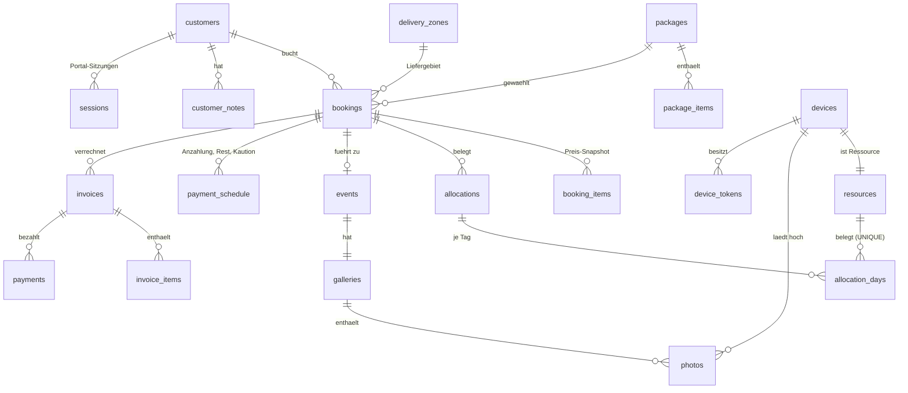

# Datenbank – Modell (Cloudflare D1 / SQLite)

Stand: 2026-11-25 (Version 2, umgestellt von PostgreSQL auf D1) · Umsetzung über versionierte Migrationen in `Plattform/migrations/`.

## Was ist ein ER-Diagramm?
**ER = Entity-Relationship** (Gegenstand–Beziehung). Jedes Kästchen ist eine **Tabelle**, jede Linie eine **Beziehung**.
`||` = genau eins, `o{` = keins oder mehrere. Beispiel: *Ein Kunde hat keine oder mehrere Buchungen; jede Buchung gehört zu genau einem Kunden.*
Verbunden über **Fremdschlüssel**: `bookings.customer_id` zeigt auf `customers.id`.

## Was ändert sich mit D1?
| Thema | PostgreSQL (V1) | **D1 (V2)** |
|---|---|---|
| Doppelbuchung | Ausschlussregel auf Zeiträumen | **`allocation_days` mit UNIQUE(resource_id, day, slot)** + atomarer `batch()` |
| Transaktionen | frei | nur als `batch()` (alle Befehle vorab festgelegt) – reicht für alle Buchungsschritte |
| Zugriffsschutz | Row Level Security | **keine RLS** → Zugriff ausschliesslich über Worker-Code mit Rollenprüfung; Browser spricht nie direkt mit D1 |
| Typen | uuid, timestamptz, jsonb | IDs als TEXT (zufällig, 128 Bit), Zeit als TEXT ISO-8601 UTC, JSON als TEXT mit `json_valid`-CHECK |
| Fremdschlüssel | immer aktiv | in D1 aktiv (Prüfung im Test) |
| Geld | integer Rappen | integer Rappen (unverändert) |

## ER-Diagramm (Kern)


## Tabellen (● V1, ○ später)
| Modul | Tabelle | | Zweck / wichtige Felder |
|---|---|---|---|
| Admin | `admin_users` | ● | E-Mail (muss zu Cloudflare-Access-Identität passen), Rolle `owner/admin/staff`, aktiv |
| CRM | `customers` | ● | Name, Firma, E-Mail (`UNIQUE COLLATE NOCASE`), Telefon, Rechnungsadresse, Sprache |
| CRM | `customer_notes` | ● | Notizen und Kommunikationshistorie |
| Portal | `magic_links` | ● | `token_hash` UNIQUE, customer_id, `expires_at`, `used_at` |
| Portal | `sessions` | ● | `session_hash` UNIQUE, customer_id, Ablauf, widerrufen |
| Katalog | `packages`, `package_items`, `add_ons` | ● | Preise in Rappen, inkl. Abzüge, sichtbar, Reihenfolge; Texte mit `locale` |
| Liefergebiet | `delivery_zones` | ● | Name, **Kantone** (Liste), **PLZ-Bereiche**, max. Distanz km, Pauschale + Preis/km, Abholung erlaubt, **Sofortbuchung erlaubt**, Mindestvorlauf Tage (Standard 7), Puffertage vor/nach |
| Ressourcen | `resources` | ● | Typ `device` oder `delivery` (Liefer-Kapazität), Kapazität (Anzahl Slots/Tag) |
| Buchung | `bookings` | ● | Nummer, Status, Kunde, Paket, Event-Daten, Adresse, PLZ, Gäste, Lieferart, Zone, Summen (Snapshot), AGB-Version |
| Buchung | `booking_items` | ● | Positionen als Snapshot (Text, Menge, Einzelpreis Rappen) |
| Buchung | `allocations` | ● | Typ `hold/booking/maintenance/block`, booking_id?, `expires_at` (bei hold) |
| Buchung | `allocation_days` | ● | allocation_id, resource_id, `day` (YYYY-MM-DD, Europe/Zurich), `slot`; **UNIQUE(resource_id, day, slot)** |
| Buchung | `booking_history` | ● | wer, wann, Feld, alt → neu |
| Zahlung | `payment_schedule` | ● | Art `deposit/balance/security_deposit`, Betrag oder %, fällig am, Status |
| Geräte | `devices`, `device_tokens`, `device_reports` | ● | wie V1; Token nur als Hash |
| Galerie | `events`, `galleries`, `photos` | ● | wie V1; `photos` mit Objektpfaden Original/Web/Vorschau, Bytes, `client_photo_id` UNIQUE je Gerät |
| Finanzen | `invoices`, `invoice_items`, `payments` | ● | Nummer lückenlos, nach Ausstellung gesperrt (Trigger verhindert UPDATE), PDF-Pfad + SHA-256 |
| Finanzen | `expenses` | ○ | Ausgaben effektiv/kalkulatorisch |
| Mail | `email_templates`, `outbox` | ● | `dedupe_key` UNIQUE, Status, Versuche, Testmodus, Sendetag (für 80/Tag-Drossel) |
| Inhalte | `content_blocks`, `faqs`, `posts`, `redirects`, `seo_meta` | ●/○ | alle mit `locale` (Standard `de-CH`) |
| System | `settings` | ● | u. a. `print_cost_rappen`=15, `vat_enabled`=0, `vat_rate`, `deposit_percent`=30 (vorläufig), `hold_minutes`=15, `min_lead_days`=7, R2-Grenzen |
| System | `usage_counters` | ● | Tag/Monat, Dienst, Zähler (R2-Bytes, A/B-Vorgänge, Mails, Uploads) |
| System | `audit_log` | ● | nur anhängen |

## Buchungs-Batch (Pseudo-SQL)
```sql
-- alles in EINEM db.batch([...]) → atomar
DELETE FROM allocation_days WHERE allocation_id IN (SELECT id FROM allocations WHERE type='hold' AND expires_at < :now);
DELETE FROM allocations WHERE type='hold' AND expires_at < :now;
INSERT INTO allocations (id, type, expires_at) VALUES (:a, 'hold', :now_plus_15);
INSERT INTO allocation_days (allocation_id, resource_id, day, slot) VALUES
  (:a, :device, '2027-06-11', 1),   -- Liefertag/Puffer
  (:a, :device, '2027-06-12', 1),   -- Eventtag
  (:a, :delivery, '2027-06-11', :freier_slot);
-- UNIQUE-Verletzung irgendwo → gesamter Batch zurückgerollt
```
Abschluss: `UPDATE allocations SET type='booking', booking_id=…, expires_at=NULL WHERE id=:a AND type='hold' AND expires_at > :now`
plus `INSERT INTO bookings …` im selben Batch; der Worker prüft, dass das UPDATE genau 1 Zeile geändert hat, sonst Abbruch.
**Test:** 50 gleichzeitige Buchungsversuche auf denselben Tag → genau einer gewinnt (automatischer Test, Phase 3).

## Statusmodelle
- **Buchung:** `request` (kurzfristig/ausserhalb Zone) · `confirmed` (Direktbuchung) → `deposit_paid` → `completed`; `cancelled`, `expired`.
- **Rechnung:** `draft` → `issued` → `paid`/`overdue`; Korrektur nur per Gutschrift.
- **Event:** `planned` → `active` → `closed` → `archived`. **Foto:** `pending` → `uploaded` → `ready` → `deleted`.

## Aufbewahrung (Entwurf, rechtlich zu prüfen)
Fotos: Web-Version Standard 30 Tage, Originale (falls hochgeladen) 14 Tage · Holds 24 h · Anfragen ohne Buchung 12 Monate ·
Buchhaltungsrelevantes 10 Jahre (Art. 958f OR) · Gerätedaten 90 Tage · Audit-Log 2 Jahre.

## Backups
D1 Time Travel (7 Tage, gratis) + wöchentlicher `wrangler d1 export` (GitHub Actions) → privater R2-Ordner `backups/` (wenige MB)
+ monatliche Wiederherstellungsprobe in eine Test-Datenbank.
